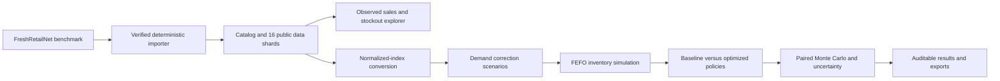

# FreshTwin

## Verified v0.5 production and demonstration release — November 22, 2026 (US/Central)

- **Live Cloudflare Workers:** https://freshtwin-inventory-digital-twin.nirman-bhowmike.workers.dev/ — v0.5 deployed and independently checked.
- **Source:** merged [PR #9](https://github.com/NirmanBhowmike/freshtwin-inventory-digital-twin/pull/9); later recording/evidence [PR #10](https://github.com/NirmanBhowmike/freshtwin-inventory-digital-twin/pull/10).
- **Technical tests:** 42/42 unit tests, build success; 36/36 browser acceptance checks on live site ([GitHub production QA](https://github.com/NirmanBhowmike/freshtwin-inventory-digital-twin/actions/runs/45088531951)).
- **Genuine screen recording:** 15 captioned scene segments, ~2 minutes 24 seconds, eight screenshots, [downloadable recorded evidence from GitHub Actions](https://github.com/NirmanBhowmike/freshtwin-inventory-digital-twin/actions/runs/45088531892/artifacts/14780725120). Video is silent/captioned, not a synthesized voiceover.
- **Course evidence:** an exactly two-page DOCX review worksheet generated from **actual public-site screenshots and calculated model outputs** and included in the same artifact. The user must review, personalize and independently submit their own discussion.
- **Scientific scope:** this is a functional assumption-driven digital-twin simulation with real anonymized benchmark context, not a field-calibrated retail operational twin or guaranteed globally optimal solver. The named vegetables never represent decoded benchmark identities.

## FreshTwin v0.5 — Phase 4: One store, jointly optimized

**New Joint Store Lab:** ten named vegetables can be managed together in one **illustrative synthetic store** with a shared refrigerated-volume ceiling and one purchasing budget for the entire planning horizon. The three constrained policies are evaluated on matched future-demand paths, with FEFO batch aging, supplier lead times, and explicit terminal inventory valuation.

**Live interface:** navigate to **Joint store lab** for editable budget, capacity, demand intensity, seed, trial count, and SKU selection; auditable volume/capital trajectories; day-by-day stock conservation; empirical Monte Carlo tail risk and confidence intervals; reproducible JSON and CSV. Individual vegetable assumption edits propagate into this scenario.

**Scientific limits:** the coupled decision rule uses a bounded sampled marginal-value heuristic with integer polishing, not a globally optimal multistage program. This lab does **not** combine anonymized benchmark product histories from different physical retailers. **The solver may rank below a simple baseline under some assumptions; this outcome must be reported honestly.** Full formulation: [Phase 4 mathematical specification](docs/PHASE4_JOINT_OPTIMIZATION.md); narrated demonstration plan: [recording storyboard](docs/PHASE4_DEMO_STORYBOARD.md) and [narration rehearsal guide](docs/PHASE4_NARRATION.md).

**Acceptance gate:** 42/42 Node tests and static build passed, and all 36/36 actual Chromium checks passed on the feature-branch server: https://github.com/NirmanBhowmike/freshtwin-inventory-digital-twin/actions/runs/45087586964. Live Cloudflare production has since been verified with 36/36 browser checks after merging.

## FreshTwin v0.4 — Phases 1–3 (preserved prior release): safer decisions and two operating modes

**Two distinct workspaces:** **Vegetable Demonstration** offers ten named products with editable demand, costs, shelf lives, lead time, opening stock and age mix. **Research Benchmark** retains 865 actual anonymized product IDs and their real normalized histories. No anonymized ID is assigned a vegetable name. Switching modes never rewrites benchmark observations.

**Scientific core:** daily FEFO balances, lead-time aware outstanding orders, cost-basis opening inventory and terminal credits for usable stock and committed pipeline, seeded paired Monte Carlo, small-instance candidate-search verification, and controlled synthetic known-demand diagnostics. The freshness-aware policy is a bounded sampled heuristic, **not a globally optimal multi-period solver**; genuine lost sales remain unobserved. See [v0.4 methodology](docs/METHODOLOGY.md) and [Phases 1–3 engineering validation](docs/PHASES_1_3_VALIDATION.md).

**New controls:** editable per-vegetable inputs, reset to baseline, explicit stale-result notice, compact provenance, exportable opening/closing inventory ledger and reproducible research JSON, and responsive decision-lab layout. `npm run check` runs model/data regressions; a separate Chromium acceptance workflow checks rapid product selection, exports and 390/768/1512px responsiveness. The page is static and needs no paid AI key.

**Verified release acceptance:** the branch passed **28/28 Node-based tests and a production build** in GitHub Actions and **24/24 actual Chromium interactive checks** including real benchmark assets, 128-trial Monte Carlo, mode switching, exports, seed reproducibility, and 390/768/1512px layouts. The live Cloudflare website **passed 24/24 browser acceptance checks** after release and serves the attributed real-data catalog. Phase 4 joint-capacity/joint-budget optimization has **not** been implemented.

**Stockout-aware demand intelligence and perishable-inventory decision support**

[](https://github.com/NirmanBhowmike/freshtwin-inventory-digital-twin/actions/workflows/ci.yml)

[**Open the public application**](https://freshtwin-inventory-digital-twin.nirman-bhowmike.workers.dev/) · [Read methodology](docs/METHODOLOGY.md) · [Dataset and attribution](docs/DATA_SOURCE.md)

FreshTwin is an interactive inventory-research application developed for **INEN-5350 Production & Inventory Control**. It illustrates how stockout-censored sales affect replenishment planning for perishable goods. Its user experience puts the product data first, followed by model selection, transparent simulation, inventory aging and risk-aware comparison.

## Verified release and production quality

- **Public app:** [FreshTwin on Cloudflare Workers](https://freshtwin-inventory-digital-twin.nirman-bhowmike.workers.dev/)
- **28/28** Node tests and production static build: [GitHub quality evidence](https://github.com/NirmanBhowmike/freshtwin-inventory-digital-twin/actions/runs/45085398163).
- **24/24** Chromium checks against the **actual public Cloudflare URL**, including live data fetch, responsive 390/768/1512px layouts, deterministic seed, catalog selection, CSV and exports: [production acceptance evidence](https://github.com/NirmanBhowmike/freshtwin-inventory-digital-twin/actions/runs/45085856763).
- **Research status:** Phases 1–3 complete and technically verified. Phase 4 joint multi-product optimization intentionally not started. Outputs are simulation-based with explicit assumptions; a production browser test does not establish field validity.

## Product capabilities

- **Joint Store Lab (v0.5):** jointly allocate replenishment among up to ten illustrative vegetables under one total-horizon budget and one conservative storage reservation, comparing three feasible policies on paired simulated demand paths.


- Choose **Vegetable Demonstration** to model ten named produce products with editable cost, demand, supplier, shelf life and opening inventory assumptions, or **Research Benchmark** to analyze 865 real anonymized product IDs without inventing their names.
- Audit the explicit stock-flow and net scenario-cost objective directly on the Methodology page, with cost breakdowns and Monte Carlo convergence diagnostics.

- Search, category-filter and sort a catalog of **865 anonymized product IDs** from Dingdong's FreshRetailNet-50K source, once the verified data import succeeds.
- Inspect one representative **actual 90-day store history per product** including normalized daily/hourly sales, stockout exposure, promotions and discount context.
- See real observed data in its original normalized scale; separately explore scenario inventory constructed from that index.
- Compare observed-sales, stockout-adjusted, and freshness-aware replenishment policies.
- Inspect a day-by-day FEFO (first-expiring-first-out) inventory ledger, modeled batch aging and future purchase orders.
- Run paired, seeded Monte Carlo experiments, visualize service-versus-waste trade-offs and export the model's results.
- Run a pseudo-stockout backtest that masks late-day sales of fully observed days and measures partial-day recovery error.
- Import a simple physical-unit CSV privately in the browser as an alternate source for a selected scenario.

> **Source separation:** Historical benchmark sales and stockouts are real anonymized data. Product names, physical stock-on-hand, costs, shelf lives, true lost demand and actual waste are *not* supplied. Forward replenishment/waste/cost outcomes remain **simulations using declared assumptions**, not verified business savings. Source [details](docs/DATA_SOURCE.md).

## Quick start

Node.js 20 or higher. No runtime npm dependencies required.

```bash
npm run dev
# Open http://localhost:4173
npm run check  # engine, provenance and empirical tests
npm run build  # deployable output in dist/
```

To generate the actual publisher-derived catalog locally:

```bash
python -m pip install pandas pyarrow
python scripts/import_freshretail.py
npm run build
```

The publisher-derived catalog and 16 attributed history shards are already committed and independently audited; re-running the importer is optional for reproducibility. A missing catalog triggers an explicit, labeled example-mode fallback, **not a fabricated catalog**.

## Model diagram



The importer chooses **one store-product series for each anonymized product**; it does not claim the catalog's 865 items were stocked together at a single store.

## Source dataset and attribution

**FreshRetailNet-50K** © Dingdong-Inc, licensed **CC BY 4.0**. Data developer: Dingdong-Inc. Dataset paper: Wang, Y., Gu, J., Long, L., Li, X., Shen, L., Fu, Z., Zhou, X., and Jiang, X. (2025). *FreshRetailNet-50K: A Stockout-Annotated Censored Demand Dataset for Latent Demand Recovery and Forecasting in Fresh Retail.* [arXiv:2505.16319](https://arxiv.org/abs/2505.16319). [Original dataset and license](https://huggingface.co/datasets/Dingdong-Inc/FreshRetailNet-50K).

The extracted benchmark JSON files in `public/data/` preserve CC BY 4.0 attribution; the original datasets are not relicensed by this repository. The original data's anonymized identifiers are presented faithfully. See [DATA_SOURCE.md](docs/DATA_SOURCE.md) for schema, selection algorithm, source hash, preparation script, assumptions and license details.

## Methodology, risks and verification

The model's stockout-aware adjustment is an availability-based **heuristic**. The pseudo-stockout backtest measures reconstruction of *artificially hidden observed sales*, not unidentified latent demand on genuine stockout days. The scenario optimizer performs a bounded Monte Carlo/grid-search approximation; no claim of global optimality is made. Revenue/cost numbers arise from illustrative unit economics.

- Mathematical model: [docs/METHODOLOGY.md](docs/METHODOLOGY.md)
- Dataset provenance: [docs/DATA_SOURCE.md](docs/DATA_SOURCE.md)
- Validation and test limitations: [docs/VALIDATION.md](docs/VALIDATION.md) and [v0.3 independent data audit](docs/QUALITY_REPORT_V03.md)
- Product requirements: [docs/PRODUCT_REQUIREMENTS.md](docs/PRODUCT_REQUIREMENTS.md) and [docs/PRODUCT_REQUIREMENTS_V03.md](docs/PRODUCT_REQUIREMENTS_V03.md)
- Project continuity and latest verified state: [PROJECT_STATE.md](PROJECT_STATE.md)

Run `npm run check` before merging; confirm the Cloudflare `workers.dev` site and interaction behavior separately. Build and unit tests do not substitute for a live-browser acceptance test.

## Cloudflare Workers deployment

`wrangler.jsonc` configures Cloudflare Workers **Static Assets** from `dist/`. Git-connected build command: `npm run build`; deployment command: `npx wrangler deploy`; production branch: `main`; root `/`. No LLM API key or database is required for the static benchmark explorer. Cloudflare should auto-deploy the protected `main` branch after a verified PR is merged.

## Usage restrictions and source license

**No open-source license is granted for the author's original application source code.** Public viewing and GitHub's standard functionality are subject to GitHub terms. The separate Dingdong-Inc dataset remains covered by its own **CC BY 4.0 license** and attribution obligations, even when included in public deployment assets. Do not publish third-party private data or deployment secrets.