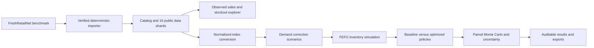

# FreshTwin

**Stockout-aware demand intelligence and perishable-inventory decision support**

[](https://github.com/NirmanBhowmike/freshtwin-inventory-digital-twin/actions/workflows/ci.yml)

[**Open the public application**](https://freshtwin-inventory-digital-twin.nirman-bhowmike.workers.dev/) · [Read methodology](docs/METHODOLOGY.md) · [Dataset and attribution](docs/DATA_SOURCE.md)

FreshTwin is an interactive inventory-research application developed for **INEN-5350 Production & Inventory Control**. It illustrates how stockout-censored sales affect replenishment planning for perishable goods. Its user experience puts the product data first, followed by model selection, transparent simulation, inventory aging and risk-aware comparison.

## Product capabilities

- Search, category-filter and sort a catalog of **865 anonymized product IDs** from Dingdong's FreshRetailNet-50K source, once the verified data import succeeds.
- Inspect one representative **actual 90-day store history per product** including normalized daily/hourly sales, stockout exposure, promotions and discount context.
- See real observed data in its original normalized scale; separately explore scenario inventory constructed from that index.
- Compare observed-sales, stockout-adjusted, and freshness-aware replenishment policies.
- Inspect a day-by-day FEFO (first-expiring-first-out) inventory ledger, modeled batch aging and future purchase orders.
- Run paired, seeded Monte Carlo experiments, visualize service-versus-waste trade-offs and export the model's results.
- Run a pseudo-stockout backtest that masks late-day sales of fully observed days and measures partial-day recovery error.
- Import a simple physical-unit CSV privately in the browser as an alternate source for a selected scenario.

> **Source separation:** Historical benchmark sales and stockouts are real anonymized data. Product names, physical stock-on-hand, costs, shelf lives, true lost demand and actual waste are *not* supplied. Forward replenishment/waste/cost outcomes remain **simulations using declared assumptions**, not verified business savings. Source [details](docs/DATA_SOURCE.md).

## Quick start

Node.js 20 or higher. No runtime npm dependencies required.

```bash
npm run dev
# Open http://localhost:4173
npm run check  # engine, provenance and empirical tests
npm run build  # deployable output in dist/
```

To generate the actual publisher-derived catalog locally:

```bash
python -m pip install pandas pyarrow
python scripts/import_freshretail.py
npm run build
```

For the first public release, run the GitHub ingestion workflow on the feature branch and verify that the generated data shards are present. A missing catalog triggers an explicit, labeled example-mode fallback, **not a fabricated catalog**.

## Model diagram



The importer chooses **one store-product series for each anonymized product**; it does not claim the catalog's 865 items were stocked together at a single store.

## Source dataset and attribution

**FreshRetailNet-50K** © Dingdong-Inc, licensed **CC BY 4.0**. Data developer: Dingdong-Inc. Dataset paper: Wang, Y., Gu, J., Long, L., Li, X., Shen, L., Fu, Z., Zhou, X., and Jiang, X. (2025). *FreshRetailNet-50K: A Stockout-Annotated Censored Demand Dataset for Latent Demand Recovery and Forecasting in Fresh Retail.* [arXiv:2505.16319](https://arxiv.org/abs/2505.16319). [Original dataset and license](https://huggingface.co/datasets/Dingdong-Inc/FreshRetailNet-50K).

The extracted benchmark JSON files in `public/data/` preserve CC BY 4.0 attribution; the original datasets are not relicensed by this repository. The original data's anonymized identifiers are presented faithfully. See [DATA_SOURCE.md](docs/DATA_SOURCE.md) for schema, selection algorithm, source hash, preparation script, assumptions and license details.

## Methodology, risks and verification

The model's stockout-aware adjustment is an availability-based **heuristic**. The pseudo-stockout backtest measures reconstruction of *artificially hidden observed sales*, not unidentified latent demand on genuine stockout days. The scenario optimizer performs a bounded Monte Carlo/grid-search approximation; no claim of global optimality is made. Revenue/cost numbers arise from illustrative unit economics.

- Mathematical model: [docs/METHODOLOGY.md](docs/METHODOLOGY.md)
- Dataset provenance: [docs/DATA_SOURCE.md](docs/DATA_SOURCE.md)
- Validation and test limitations: [docs/VALIDATION.md](docs/VALIDATION.md)
- Product requirements: [docs/PRODUCT_REQUIREMENTS.md](docs/PRODUCT_REQUIREMENTS.md) and [docs/PRODUCT_REQUIREMENTS_V03.md](docs/PRODUCT_REQUIREMENTS_V03.md)
- Project continuity and latest verified state: [PROJECT_STATE.md](PROJECT_STATE.md)

Run `npm run check` before merging; confirm the Cloudflare `workers.dev` site and interaction behavior separately. Build and unit tests do not substitute for a live-browser acceptance test.

## Cloudflare Workers deployment

`wrangler.jsonc` configures Cloudflare Workers **Static Assets** from `dist/`. Git-connected build command: `npm run build`; deployment command: `npx wrangler deploy`; production branch: `main`; root `/`. No LLM API key or database is required for the static benchmark explorer. Cloudflare should auto-deploy the protected `main` branch after a verified PR is merged.

## Usage restrictions and source license

**No open-source license is granted for the author's original application source code.** Public viewing and GitHub's standard functionality are subject to GitHub terms. The separate Dingdong-Inc dataset remains covered by its own **CC BY 4.0 license** and attribution obligations, even when included in public deployment assets. Do not publish third-party private data or deployment secrets.