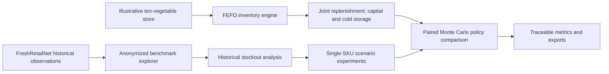

# FreshTwin

**Inventory intelligence for perishable retail systems.** FreshTwin is a fully functional, publicly accessible research prototype for stockout-aware demand analysis, FEFO inventory simulation, and constrained stochastic replenishment.

[](https://github.com/NirmanBhowmike/freshtwin-inventory-digital-twin/actions/workflows/ci.yml)

**[Launch FreshTwin v0.5](https://freshtwin-inventory-digital-twin.nirman-bhowmike.workers.dev/)** · [Mathematical methodology](docs/METHODOLOGY.md) · [Dataset provenance](docs/DATA_SOURCE.md) · [Joint optimization details](docs/PHASE4_JOINT_OPTIMIZATION.md)

## What the application does

| Workspace | Core capability | Data basis |
| --- | --- | --- |
| Vegetable Demo | Ten named vegetables, editable demand, shelf life, aging, inventory, prices and lead times; FEFO ledger and single-product policy comparisons | Explicitly illustrative inputs |
| Research Benchmark | Search, sort and examine 865 anonymized product IDs, with 90 days of genuine historical sales and stockout observations per selected series | Dingdong FreshRetailNet-50K, original normalized scale |
| Decision Lab | Compare recorded-sales, stockout-adjusted and freshness-aware ordering using paired stochastic scenarios, cost decomposition, fill rate, expiration and sample CVaR90 | Scenario model, not measured operational savings |
| Joint Store Lab | Allocate replenishment across up to ten illustrative vegetables subject to **one all-horizon procurement budget** and **one conservative shared cold-storage limit** | A coherent hypothetical single store with paired simulated demand |

The Joint Store Lab implements **Phase 4** in v0.5. All three policies obey the same hard resource limits. Its coupled marginal-value allocator uses sampled FEFO cost curves and constrained integer refinement; it is an **approximation**, not a globally certified multistage optimizer.

## Scientific provenance

FreshRetailNet-50K records normalized sales and stockout indicators; it does **not** disclose product names, actual physical on-hand inventory, verified spoilage, shelf lives, cost inputs or genuine latent demand. The 865-item catalog selects a representative 90-day store-product history for each anonymized identifier, potentially from different stores. **These histories are never combined and presented as one real store.**

The named produce are separate **synthetic operating scenarios**. Any illustrated financial outcome, future demand estimate or claimed inventory cost is generated under declared assumptions, not independently observed retailer savings. The stockout adjustment is heuristic; pseudo-stockout evaluations only recover deliberately hidden observable sales.

**Dataset attribution:** Dingdong-Inc, [FreshRetailNet-50K](https://huggingface.co/datasets/Dingdong-Inc/FreshRetailNet-50K), **CC BY 4.0**. Wang et al. (2025), [arXiv:2505.16319](https://arxiv.org/abs/2505.16319). The benchmark assets retain the publisher's license, distinct from this project's source-code rights. See [DATA_SOURCE.md](docs/DATA_SOURCE.md).

## Technical architecture

- Static browser UI built with HTML, CSS and JavaScript; no paid AI key, database or network access to private business systems.
- Deterministic seeded demand paths, stockout-censored sales adjustment, FEFO age cohorts, lead-time pipelines and daily mass-balance checks.
- Cost-basis opening and terminal inventory/pipeline accounting, common-random-number Monte Carlo, explicit uncertainty indicators and reproducible results exports.
- Joint hard constraints: cumulative modeled purchasing expenditures never exceed the configured budget; reserved refrigerated space for on-hand and outstanding order quantities never exceeds capacity.
- Reproducible importer for licensed benchmark parquet data; 16 attributed static history shards in `public/data/`.



## Verification

- **42/42 Node model and provenance tests** passed on v0.5, including reduced finite-instance exhaustive allocation checks.
- **36/36 interactive Chromium checks** passed against the deployed Cloudflare v0.5 app (24 general + 12 joint-store checks), including 390/768/1512px layouts, real data fetching, deterministic replay, and resource constraint reconciliation. [Production run](https://github.com/NirmanBhowmike/freshtwin-inventory-digital-twin/actions/runs/45088531951).
- CI validates syntax, numerical invariants, build artifacts and browser workflows; further scenario-sensitivity benchmarks are reproducible through `npm run benchmark` (see [OPTIMIZATION_BENCHMARKS.md](docs/OPTIMIZATION_BENCHMARKS.md)).
- Scientific limitations remain: normalized/anonymized source histories, unobserved lost demand, uncalibrated physical unit economics, heuristic multi-period optimization and no real-store field trial.

## Local development

Requires Node.js 20+; application dependencies are built in.

```bash
npm run dev         # http://localhost:4173
npm run check       # model, source and numerical tests
npm run benchmark   # reproducible simulated constraint/policy sensitivity
npm run build       # builds static assets into dist/
```

Optional reproducible benchmark data import (the verified 865-item extract is already committed):

```bash
python -m pip install pandas pyarrow
python scripts/import_freshretail.py
npm run build
```

## Deployment and documentation

`wrangler.jsonc` configures Cloudflare Workers Static Assets from `dist/`. Git-connected build command: `npm run build`. Deployment: `npx wrangler deploy` on protected `main`; no application secrets required.

- [Methods and model accounting](docs/METHODOLOGY.md)
- [Joint solver formulation and validation](docs/PHASE4_JOINT_OPTIMIZATION.md)
- [Optimization sensitivity benchmarks](docs/OPTIMIZATION_BENCHMARKS.md)
- [Dataset import, attribution and hashes](docs/DATA_SOURCE.md)
- [Verification methodology](docs/VALIDATION.md)
- [Product requirements and acceptance](docs/PRODUCT_REQUIREMENTS.md)
- [Project continuity and release status](PROJECT_STATE.md)

## Licensing and security

The author's original source code is publicly viewable but **is not offered under an open-source license**. The publisher's included dataset retains its separate CC BY 4.0 license and attribution. Do not commit private data, credentials or deployment tokens.
